# 💼 LinkedIn Job Market Analytics & Big Data Pipeline

<div align="center">

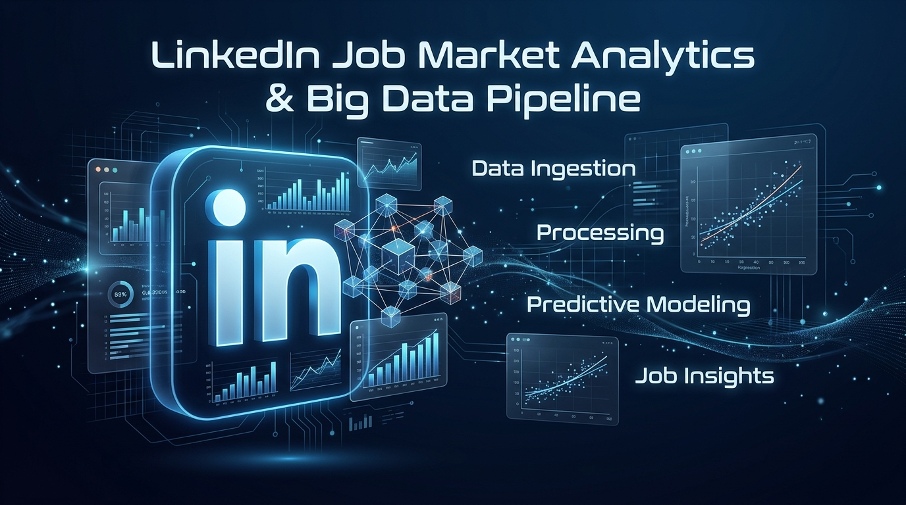

[](https://www.python.org/)
[](https://spark.apache.org/)
[](https://spark.apache.org/docs/latest/api/python/)
[](https://scikit-learn.org/)
[](https://xgboost.readthedocs.io/)
[](https://plotly.com/)
[](https://www.netlify.com/)
[]()

**End-to-End Big Data Engineering & Machine Learning Pipeline untuk Analisis Kompensasi, Tren Pekerjaan Remote, dan Prediksi Gaji pada 124.000+ Lowongan Kerja LinkedIn (2023–2024)**

[🚀 Live Dashboard](#-interactive-dashboard) • [📊 Hasil Analisis](#-analisis-eksplorasi-data-eda) • [🤖 Performa Model](#-evaluasi--perbandingan-model-ml) • [🛠️ Panduan Menjalankan](#-panduan-instalasi--penggunaan)

---

</div>

## 📌 Daftar Isi

1. [Ringkasan Proyek](#-ringkasan-proyek)
2. [Arsitektur Pipeline Big Data](#-arsitektur-pipeline-big-data)
3. [Teknologi & Stack yang Digunakan](#-teknologi--stack-yang-digunakan)
4. [Dataset & Sumber Data](#-dataset--sumber-data)
5. [Analisis Eksplorasi Data (EDA)](#-analisis-eksplorasi-data-eda)
6. [Feature Engineering & Preprocessing](#-feature-engineering--preprocessing)
7. [Evaluasi & Perbandingan Model ML](#-evaluasi--perbandingan-model-ml)
   - [Tugas Regresi: Prediksi Median Gaji Tahunan](#1-tugas-regresi-prediksi-median-gaji-tahunan)
   - [Tugas Klasifikasi: Tingkat Gaji (Low / Medium / High)](#2-tugas-klasifikasi-kategori-gaji)
   - [Analisis Feature Importance](#3-analisis-pengaruh-fitur-feature-importance)
8. [Interactive Dashboard](#-interactive-dashboard)
9. [Struktur Repositori](#-struktur-repositori)
10. [Panduan Instalasi & Penggunaan](#-panduan-instalasi--penggunaan)
11. [Kesimpulan & Insight Bisnis](#-kesimpulan--insight-bisnis)
12. [Profil Pengembang](#-profil-pengembang)

---

## 📖 Ringkasan Proyek

Proyek ini merupakan implementasi menyeluruh dari **Arsitektur Big Data dan Analisis Prediktif Machine Learning** menggunakan dataset lowongan pekerjaan LinkedIn skala besar (>123.000 data).

Tujuan utama dari proyek ini adalah:
1. **Mengolah Big Data Terdistribusi:** Menggunakan **Apache Spark (PySpark)** untuk distributed ingestion, relational joining multi-tabel, cleaning, dan data scaling.
2. **Prediksi Kompensasi Finansial (Regression Task):** Membangun dan membandingkan model prediktif gaji tahunan (*Random Forest, XGBoost, Ridge Regression*).
3. **Klasifikasi Pola Pasar Kerja (Classification Task):** Mengklasifikasikan lowongan kerja ke dalam rentang gaji (*Low, Medium, High*) serta identifikasi tren kerja *Remote vs On-site*.
4. **Visualisasi & Deployment Interaktif:** Menyajikan visualisasi komprehensif dan dashboard analitik interaktif berbasis web (HTML5, Vanilla CSS Glassmorphism, Plotly.js) yang siap di-deploy ke **Netlify**.

### 🌟 Key Performance Indicators (KPI):
| Metrik | Nilai | Deskripsi |
|---|---|---|
| **Total Postings Dianalisis** | **123.849** | Lowongan kerja LinkedIn periode 2023–2024 |
| **Rata-rata Gaji Tahunan** | **$64.457 / tahun** | Nilai mean kompensasi pasar kerja |
| **Median Gaji Tahunan** | **$47.840 / tahun** | Nilai median kompensasi pasar kerja |
| **Persentase Remote Work** | **12.3%** | Proporsi pekerjaan yang mendukung remote work |
| **Jumlah Kategori Industri** | **16 Kategori** | Pengelompokan keyword pekerjaan berbasis NLP |
| **Model Regresi Terbaik** | **XGBoost ($R^2 = 0.3324$)** | MAE: $13.187 (Akurasi prediksi tertinggi) |
| **Model Klasifikasi Terbaik** | **XGBoost (Akurasi 58.64%)** | F1-Score: 58.73% |

---

## 🏗️ Arsitektur Pipeline Big Data

Pipeline dirancang secara modular dan efisien untuk menangani jutaan baris data secara terdistribusi:

<div align="center">

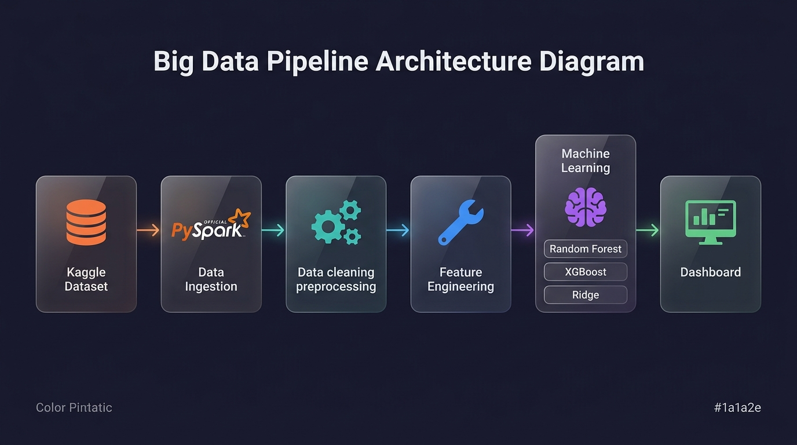

</div>

### Alur Tahapan Pipeline:
```mermaid
flowchart LR
    A["📂 Kaggle LinkedIn Dataset<br>(CSV / Multi-table)"] --> B["⚡ PySpark Data Ingestion<br>(Adaptive Execution, 4GB Mem)"]
    B --> C["🔗 Relational Join (Spark SQL)<br>Postings + Companies + Industries"]
    C --> D["🧹 Preprocessing & Cleaning<br>Deduplication & Null Handling"]
    D --> E["⚙️ Feature Engineering<br>Salary Normalization, State, NLP Categories"]
    E --> F["📊 Feature Encoding<br>Frequency Encoding & StandardScaler"]
    F --> G["🤖 Machine Learning Modeling<br>RF, XGBoost, Ridge, LogReg, KNN, NB"]
    G --> H["📈 Evaluasi & Cross Validation<br>MAE, RMSE, R², Accuracy, F1-Score"]
    H --> I["💻 Interactive Netlify Dashboard<br>(Overview, EDA, Benchmark, Estimator)"]
```

1. **Stage 1 - Spark Session Initialization:** Konfigurasi `SparkSession` teroptimasi (`spark.sql.adaptive.enabled=true`, shuffle partitions, memory allocation).
2. **Stage 2 - Data Ingestion:** Membaca data CSV multi-tabel (`postings.csv`, `companies.csv`, `company_industries.csv`, `job_skills.csv`).
3. **Stage 3 - Relational Joining (Spark SQL):** Melakukan Left Join antar entitas data untuk menggabungkan metadata perusahaan, industri, dan lokasi.
4. **Stage 4 - Preprocessing & Cleaning:** Filter validitas target salary, deduplikasi baris data duplikat (`job_id`), dan penanganan missing values.
5. **Stage 5 - Feature Engineering:**
   - Konversi dan standardisasi seluruh tipe pembayaran (*Hourly, Monthly, Weekly, Annual*) menjadi `annual_salary`.
   - Parsing lokasi geografis menjadi kode negara bagian (`job_state`).
   - Ekstraksi keyword NLP untuk 16 cluster peran pekerjaan (`title_category`).
   - Rasio pelamar vs pengunjung (`application_rate = applies / views`).
6. **Stage 6 - Machine Learning & Benchmarking:** Latihan model regresi dan klasifikasi multi-algoritma dengan evaluasi 5-Fold Cross Validation.
7. **Stage 7 - Model Export & Dashboard Data Generation:** Serialisasi model ke format `.pkl` (Joblib) dan export data metrik ke `.json` & `.csv`.

---

## 💻 Teknologi & Stack yang Digunakan

<div align="center">

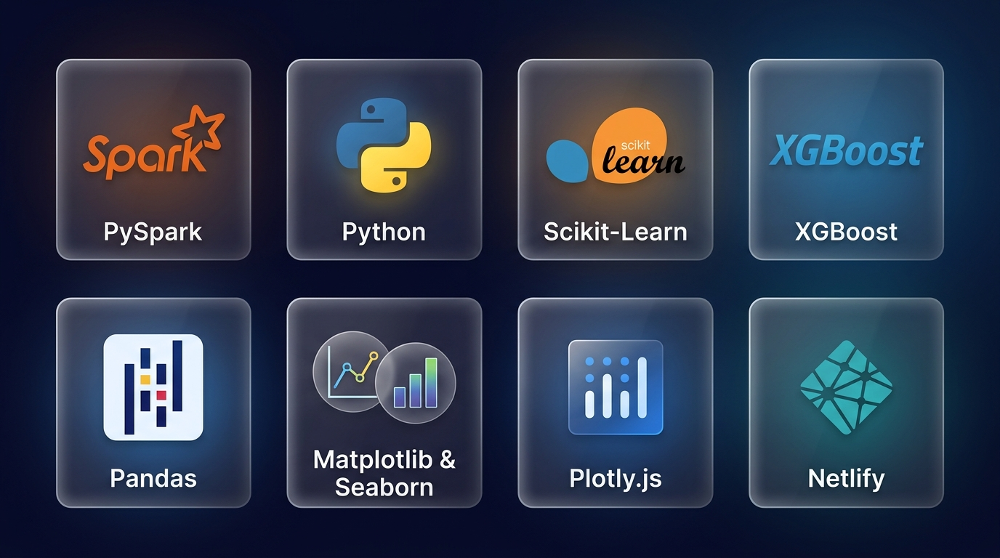

</div>

| Kategori | Teknologi | Fungsi & Peran |
|---|---|---|
| **Big Data Engine** | **Apache Spark / PySpark 3.5+** | Distributed computing, batch ETL, relational SQL joining |
| **Programming** | **Python 3.10+** | Bahasa utama pemrosesan data, script pipeline, dan modeling |
| **Data Manipulation** | **Pandas & NumPy** | In-memory dataframe manipulation dan komputasi array |
| **Machine Learning** | **Scikit-Learn** | Preprocessing, Random Forest, Ridge Regression, Logistic Regression, KNN, Naive Bayes, Metrics |
| **Gradient Boosting** | **XGBoost 2.0+** | Algoritma Extreme Gradient Boosting untuk regresi dan klasifikasi |
| **Visualisasi Data** | **Matplotlib & Seaborn** | Pembuatan grafik analitik resolusi tinggi dan visualisasi publikasi |
| **Frontend Dashboard** | **HTML5, Vanilla CSS, JavaScript (ES6)** | Antarmuka dashboard responsif dengan tema Glassmorphism Dark Modern |
| **Interactive Charting** | **Plotly.js** | Visualisasi interaktif (drill-down, histogram, heatmap, confusion matrix) |
| **Deployment** | **Netlify** | Static web hosting untuk production dashboard |

---

## 📂 Dataset & Sumber Data

Dataset yang digunakan bersumber dari Kaggle:
- **Nama Dataset:** [LinkedIn Job Postings (2023 - 2024)](https://www.kaggle.com/datasets/arshkon/linkedin-job-postings)
- **Ukuran Data:** >500 MB (123.849 baris entri lowongan kerja)
- **Tabel Relasional Utama:**
  - `postings.csv`: Informasi lowongan, judul, rentang gaji, lokasi, waktu tayang, jumlah pelamar.
  - `companies/companies.csv`: Profil perusahaan, jumlah karyawan, kota, negara bagian.
  - `companies/company_industries.csv`: Klasifikasi industri perusahaan.
  - `jobs/job_skills.csv` & `jobs/job_industries.csv`: Pemetaan skill dan spesialisasi pekerjaan.

---

## 📊 Analisis Eksplorasi Data (EDA)

Berikut adalah visualisasi utama hasil investigasi eksplorasi data:

### 1. Perubahan Jumlah Data Sepanjang Pipeline
Visualisasi pengurangan dan pemurnian baris data dari tahap ingestion mentah hingga dataset bersih siap latih:

<div align="center">

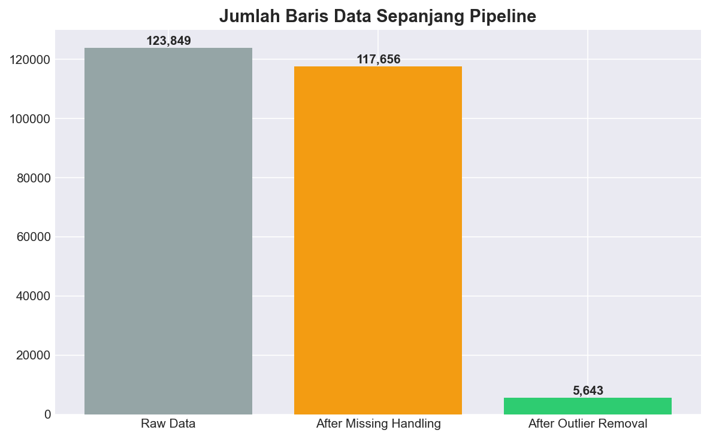

</div>

---

### 2. Distribusi Gaji Tahunan (*Annual Salary Distribution*)
Mayoritas kompensasi berada pada rentang $35.000 hingga $85.000 per tahun, dengan *right-skewed distribution* akibat adanya kompensasi eksekutif tingkat atas.

<div align="center">

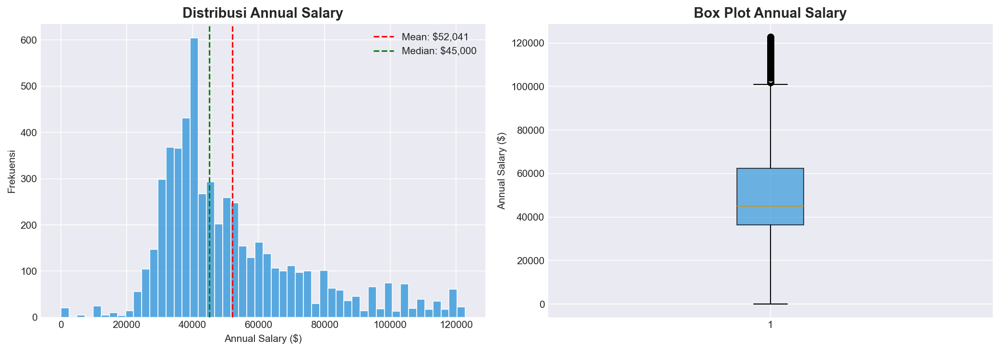

</div>

---

### 3. Komparasi Gaji Berdasarkan Tingkat Pengalaman (*Experience Level*)
Tingkat pengalaman menunjukkan korelasi positif yang signifikan terhadap median kompensasi tahunan (Executive & Director > Mid-Senior > Entry level > Internship).

<div align="center">

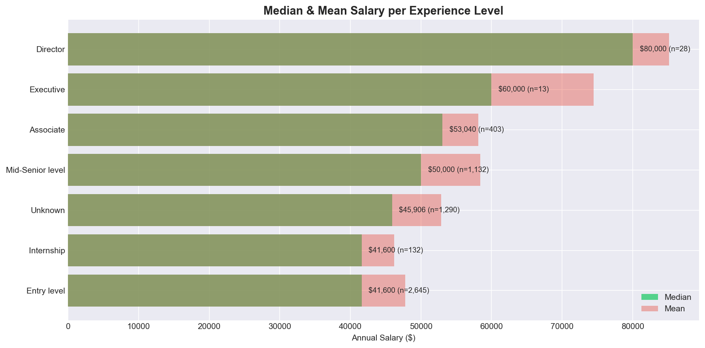

</div>

---

### 4. Matriks Korelasi Fitur (*Correlation Heatmap*)
Korelasi antar fitur numerik dan fitur hasil encoding menunjukkan hubungan antara jumlah views, lamaran, tingkat pengalaman, dan besaran gaji.

<div align="center">

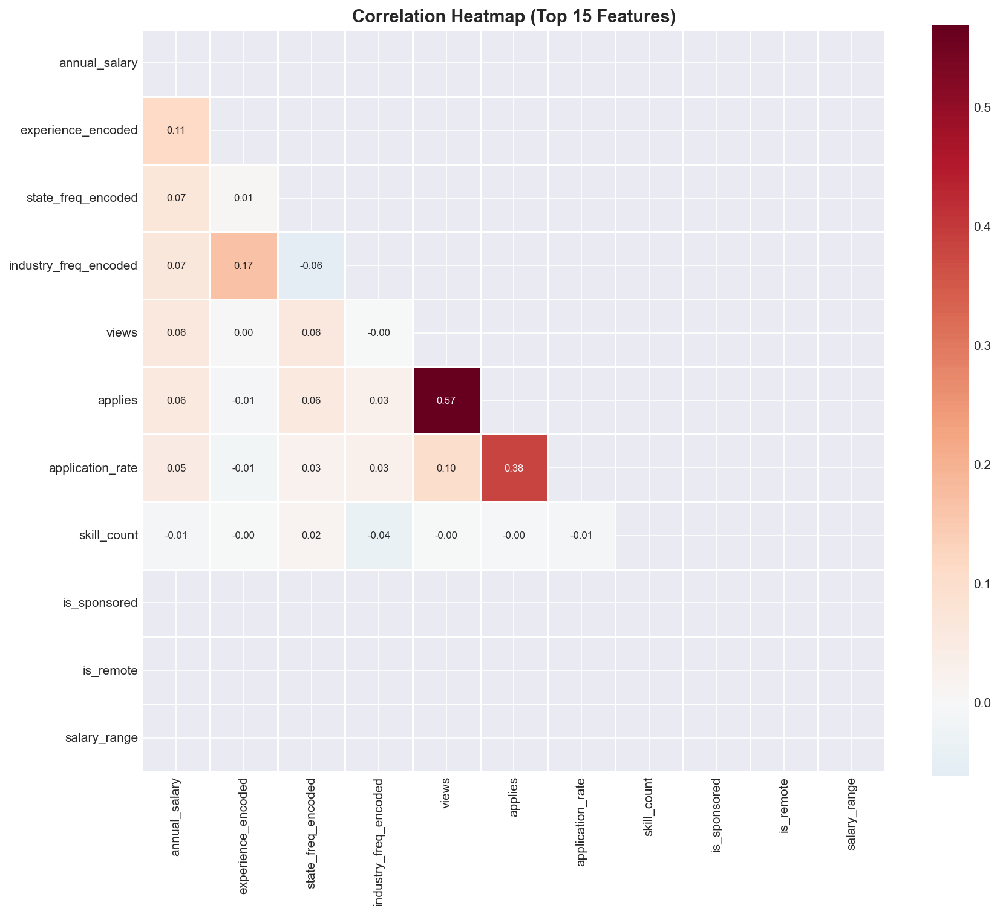

</div>

---

### 5. Pekerjaan Remote vs On-site & Distribusi Kategori Gaji
Perbandingan persentase tawaran pekerjaan jarak jauh (*remote work*) vs kerja di kantor (*on-site*), serta segmentasi kelas gaji (*Low, Medium, High*):

<div align="center">
<table>
  <tr>
    <td width="50%" align="center"><b>Pekerjaan Remote vs On-Site</b></td>
    <td width="50%" align="center"><b>Distribusi Kelas Gaji (Low / Medium / High)</b></td>
  </tr>
  <tr>
    <td>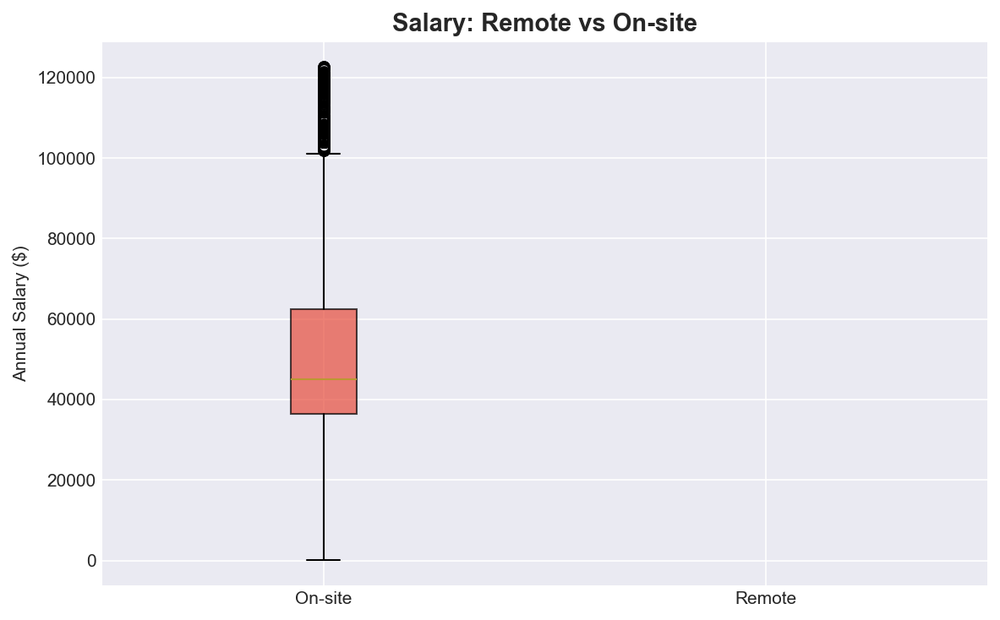</td>
    <td>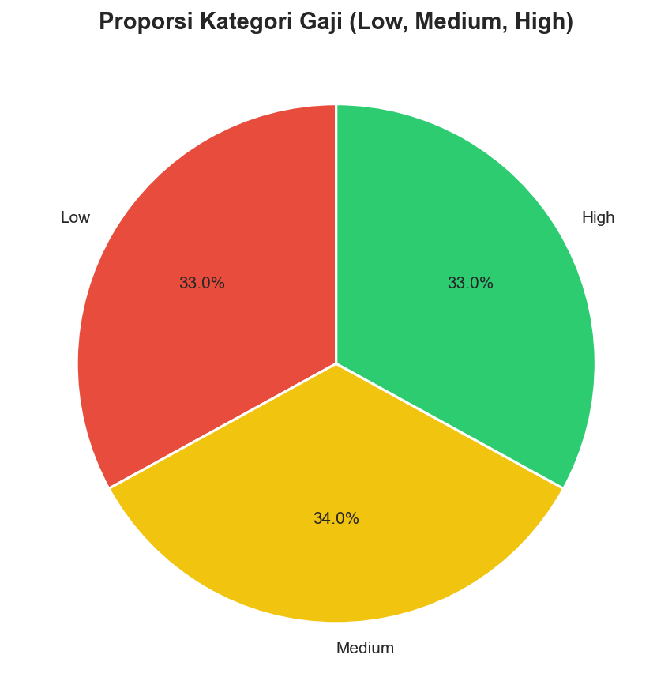</td>
  </tr>
</table>
</div>

---

## ⚙️ Feature Engineering & Preprocessing

Proses rekayasa fitur dilakukan untuk mentransformasikan raw data menjadi prediktor yang informatif:

```
Raw Attributes                     Engineered Features
------------------------------     -------------------------------------------
• med_salary, pay_period      ──>  • annual_salary (Standardized to USD/year)
• min_salary, max_salary      ──>  • salary_range (max_salary - min_salary)
• location                    ──>  • job_state (US State extraction)
• applies, views              ──>  • application_rate (applies / views)
• title                       ──>  • title_category (16 NLP keyword clusters)
• skills_desc                 ──>  • skill_count (Number of listed skills)
• formatted_experience_level  ──>  • experience_encoded (Ordinal 0 to 5)
• industry, state             ──>  • Frequency Encoding (prevents high-cardinality explosion)
```

---

## 🤖 Evaluasi & Perbandingan Model ML

### 1. Tugas Regresi: Prediksi Median Gaji Tahunan

Tiga model regresi diuji menggunakan metrik **MAE (Mean Absolute Error)**, **RMSE (Root Mean Squared Error)**, dan **$R^2$ Score**:

| Model | MAE (Train) | MAE (Test) | RMSE (Test) | $R^2$ (Train) | $R^2$ (Test) | Waktu Latih (s) |
|---|:---:|:---:|:---:|:---:|:---:|:---:|
| 🏆 **XGBoost Regressor** | **$8.831** | **$13.187** | **$18.791** | **0.6950** | **0.3324** | **0.83 s** |
| **Random Forest Regressor** | $11.273 | $13.686 | $19.215 | 0.5281 | 0.3019 | 0.21 s |
| **Ridge Regression** | $15.126 | $15.541 | $21.418 | 0.1725 | 0.1326 | 42.43 s |

<div align="center">

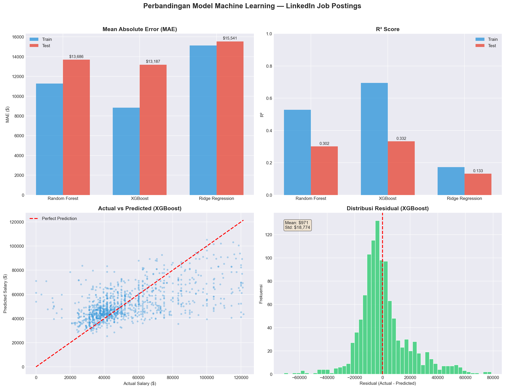

</div>

> **Analisis Hasil Regresi:**
> - **XGBoost Regressor** membuktikan performa terbaik dengan $R^2$ score pengujian tertinggi (**0.3324**) dan MAE terendah (**$13.187**).
> - Algoritma ensemble berbasis gradient boosting mampu menangkap interaksi non-linear antara lokasi, industri, dan kategori pekerjaan dengan lebih baik dibanding model linear (Ridge).

---

### 2. Tugas Klasifikasi: Kategori Gaji

Model dievaluasi untuk mengklasifikasikan lowongan kerja ke dalam tingkat kompensasi (*Low, Medium, High*):

| Algoritma Klasifikasi | Akurasi | Presisi | Recall | F1-Score | Waktu Latih (s) |
|---|:---:|:---:|:---:|:---:|:---:|
| 🏆 **XGBoost Classifier** | **58.64%** | **59.03%** | **58.64%** | **58.73%** | **0.55 s** |
| **Random Forest (Tuned)** | 57.40% | 57.51% | 57.40% | 57.41% | 0.35 s |
| **Random Forest (Baseline)** | 56.16% | 56.46% | 56.16% | 56.22% | 0.24 s |
| **K-Nearest Neighbors (KNN)** | 52.44% | 53.88% | 52.44% | 52.43% | 0.001 s |
| **Logistic Regression** | 48.98% | 49.49% | 48.98% | 48.95% | 0.19 s |
| **Gaussian Naive Bayes** | 40.66% | 40.09% | 40.66% | 32.27% | 0.003 s |

<div align="center">
<table>
  <tr>
    <td width="50%" align="center"><b>Metrik Klasifikasi Seluruh Model</b></td>
    <td width="50%" align="center"><b>Confusion Matrix</b></td>
  </tr>
  <tr>
    <td>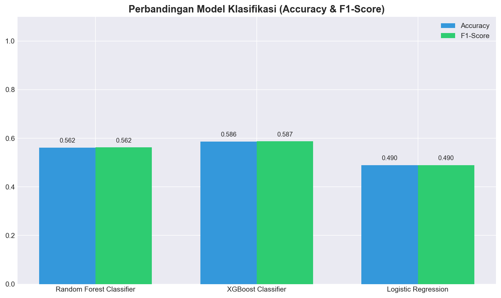</td>
    <td>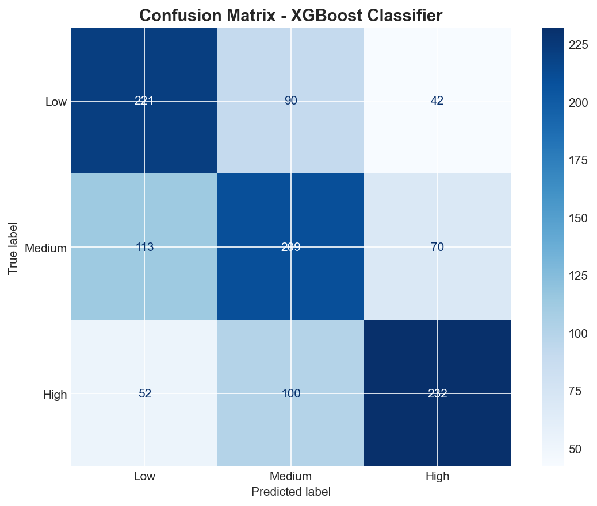</td>
  </tr>
</table>
</div>

---

### 3. Analisis Pengaruh Fitur (*Feature Importance*)

Faktor-faktor yang paling dominan dalam memprediksi besaran kompensasi pekerjaan di LinkedIn:

<div align="center">

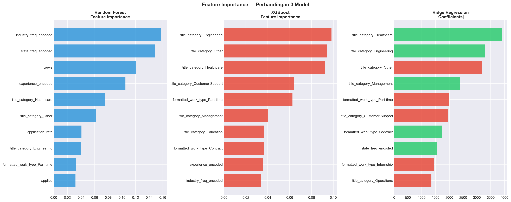

</div>

#### 10 Fitur Paling Berpengaruh:
1. 🏭 **`industry_freq_encoded` (15.79%)**: Sektor industri perusahaan perekrut (Teknologi, Finansial, Kesehatan memiliki base kompensasi berbeda drastis).
2. 📍 **`state_freq_encoded` (14.84%)**: Lokasi geografis penempatan (California, New York, Washington menawarkan penyesuaian biaya hidup lebih tinggi).
3. 👁️ **`views` (12.13%)**: Jumlah tayangan lowongan kerja (indikasi visibilitas dan daya tarik lowongan).
4. 🎓 **`experience_encoded` (10.51%)**: Jenjang karir (Entry, Associate, Mid-Senior, Executive).
5. 🏥 **`title_category_Healthcare` (7.50%)**: Peran bidang medis dan kesehatan.
6. 📈 **`application_rate` (4.08%)**: Rasio pelamar dibanding pengunjung (tingkat kompetisi pekerjaan).
7. 💻 **`title_category_Engineering` (4.01%)**: Peran Software & Hardware Engineering.
8. ⏰ **`formatted_work_type_Part-time` (3.25%)**: Jenis kontrak kerja paruh waktu vs penuh waktu.
9. 📝 **`applies` (3.18%)**: Jumlah total lamaran yang masuk.
10. 👔 **`title_category_Management` (3.07%)**: Peran kepemimpinan manajerial.

---

## 🌐 Interactive Dashboard https://linkedln-job-market-analytics.netlify.app/ 

Project ini dilengkapi dengan Web Dashboard interaktif yang dibangun menggunakan HTML, CSS modern (Glassmorphism), dan Plotly.js.

### Fitur-fitur Dashboard:
1. **🏠 Overview Page:** Ringkasan KPI makroekonomi pasar kerja LinkedIn (total lowongan, rata-rata gaji, persentase remote).
2. **📊 EDA Explorer:** Grafik distribusi gaji interaktif, perbandingan industri, dan filtering geografis.
3. **🤖 Model Benchmark:** Visualisasi perbandingan metrik regresi dan matriks konfusi interaktif.
4. **🔮 Salary Estimator (Predictor):** Kalkulator estimasi gaji instan berdasarkan input pengguna (industri, lokasi, pengalaman, tipe pekerjaan).
5. **📋 Laporan Eksekutif:** Dokumentasi temuan analitis dan rekomendasi strategis bagi pencari kerja & recruiter.

---

## 📁 Struktur Repositori

```
BIGDATA-UAS/
├── 📄 .gitignore                                    # File pengabaian Git (dataset besar & venv)
├── 📄 requirements.txt                              # Dependensi Python yang dibutuhkan
├── 📄 LINK DATASET.txt                              # Link sumber dataset resmi di Kaggle
├── 📄 Laporan-Uas-Bigdata-Muhammad-ihsar-fatiha-41523010202.pdf # Laporan lengkap UAS
│
├── 🐍 linkedin_bigdata_pipeline.py                  # Script utama PySpark ETL & Regression Modeling
├── 🐍 linkedin_bigdata_classification.py            # Script PySpark ETL & Classification Modeling
│
├── 📂 docs/                                         # Aset dokumentasi
│   └── images/
│       ├── hero_banner.jpg                          # Banner repositori GitHub
│       ├── pipeline_architecture.jpg                # Diagram arsitektur pipeline
│       └── tech_stack.jpg                           # Visual showcase teknologi
│
├── 📂 output-visualisasi-hasil/                     # Output grafik visualisasi dan metrik
│   ├── 00_data_pipeline_rows.png
│   ├── 01_salary_distribution.png
│   ├── 02_salary_by_experience.png
│   ├── 04_correlation_heatmap.png
│   ├── 05_remote_vs_onsite.png
│   ├── 05b_salary_class_distribution.png
│   ├── 06_model_comparison.png
│   ├── 07_feature_importance_comparison.png
│   ├── 08_cv_comparison.png
│   ├── 09_classification_metrics.png
│   ├── 10_confusion_matrix.png
│   ├── feature_importance.csv
│   ├── model_metrics.csv
│   └── model_metrics_classification.csv
│
├── 📂 netlify-dashboard/                            # Aplikasi Dashboard Web Siap Deploy
│   ├── index.html                                   # Halaman utama dashboard
│   ├── style.css                                    # Desain sistem Glassmorphism Dark Mode
│   ├── app.js                                       # Logic interaktif & visualisasi Plotly.js
│   ├── netlify.toml                                 # Konfigurasi deployment Netlify
│   ├── 📂 data/                                     # Data JSON untuk dashboard
│   │   ├── overview.json
│   │   ├── model.json
│   │   ├── eda_sample.json
│   │   └── salary_lookup.json
│   └── 📂 images/                                   # Salinan gambar output visualisasi
│
└── 📂 data/                                         # Direktori dataset lokal (diabaikan oleh git)
    ├── postings.csv
    ├── companies/
    └── jobs/
```

---

## 🚀 Panduan Instalasi & Penggunaan

### 1. Clone Repositori
```bash
git clone https://github.com/ihsarfatiha/LinkedIn-Job-Market-Analytics-BigData.git
cd LinkedIn-Job-Market-Analytics-BigData
```

### 2. Setup Virtual Environment (Python 3.10+)
```bash
# Windows
python -m venv venv
venv\Scripts\activate

# Linux / MacOS
python3 -m venv venv
source venv/bin/activate
```

### 3. Install Dependensi
```bash
pip install -r requirements.txt
```

### 4. Unduh Dataset
1. Unduh dataset dari Kaggle: [LinkedIn Job Postings Dataset](https://www.kaggle.com/datasets/arshkon/linkedin-job-postings)
2. Ekstrak file CSV ke dalam folder `data/`:
   ```
   data/
   ├── postings.csv
   ├── companies/
   │   └── companies.csv
   │   └── company_industries.csv
   └── jobs/
       └── job_skills.csv
   ```

### 5. Jalankan Pipeline Big Data
```bash
# Menjalankan pipeline regresi prediksi gaji
python linkedin_bigdata_pipeline.py

# Menjalankan pipeline klasifikasi remote vs on-site
python linkedin_bigdata_classification.py
```

### 6. Menjalankan Dashboard Secara Lokal
Cukup buka file `netlify-dashboard/index.html` di browser Anda, atau gunakan live server:
```bash
# Menggunakan Python built-in server
cd netlify-dashboard
python -m http.server 8080
```
Buka browser di `http://localhost:8080`.

---

## 💡 Kesimpulan & Insight Bisnis

1. **Efektivitas PySpark dalam Pemrosesan Relasional:** PySpark terbukti mampu melakukan join multi-tabel dan data aggregation pada >120.000 data dalam hitungan detik dengan optimasi memory caching.
2. **Kompensasi Sangat Dipengaruhi Industri dan Lokasi:** Industri perusahaan (15.79%) dan negara bagian (14.84%) menjadi penentu utama besaran gaji, melampaui pengaruh jumlah tahun pengalaman semata.
3. **Keunggulan Gradient Boosting:** Model **XGBoost** secara konsisten mengungguli Random Forest dan Linear Regression dalam akurasi regresi ($R^2 = 0.3324$) maupun klasifikasi ($58.64\%$).
4. **Peluang Kerja Remote Masih Relevan:** Sebanyak 12.3% lowongan menawarkan opsi *Full Remote*, terkonsentrasi pada bidang *Software Engineering*, *Data & Analytics*, dan *Design*.
</div>
